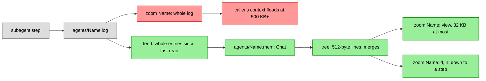

# Subagent memory

A subagent's steps used to live only in `agents/<Name>.log`, and
`zoom("Name")` gave that log whole. A subagent that ran for hours wrote
megabytes: a zoom of one filled or overflowed the caller's context, so a
fresh agent could not pick up its work by reading it.

Now each subagent's chat is a `Chat` of its own in `agents/<Name>.mem`,
with the main chat's code: the same 512-byte lines, pairwise merges, the
same compaction model and prompt, the same view and zoom. Its view is
16 to 32 KB (the main chat's is 64 to 128 KB), small enough for one tool
result. `zoom("Name")` gives the view, and `zoom("Name:id", n)` opens its
line `id+n` as `zoom(id, n)` opens the chat's.

## How it is fed

The log stays the source. After each step is written, the subagent's
chat reads the log from where it last stopped and logs the whole entries
it finds, leaving out thinking. Opened again (after a restart, or a crash
between the log and the chat), it skips as many steps as it holds,
counted as its messages' first parts: each step goes in once.

A running subagent's chat is opened at its first step and built as it
works. A subagent from before this change gets its tree at its first
zoom: the zoom answers at once, its lines not built yet showing their
heads, as the main chat's do behind a backlog, and the rest is built in
the background.

## Cost

Each subagent's chat runs at most `-agent-jobs` compactions at once (2),
so the main chat's come first. `tools/agent-mem-estimate LOG...` counts a
log's messages and the compactions its tree takes. On real logs:
about 1.1 to 1.3 compactions per message, so a 500 KB log takes about
540 compactions, about $0.43 at a Haiku compaction's average of $0.0008,
and about 25 minutes at 2 at once. A 1.4 MB log takes about 1,600.

## Prior art

[opencode-optchat](https://github.com/ahlner/opencode-optchat) keeps a
summary tree per session, subagents' included, and keeps a child's
history private to it. UniiChat and pi-optchat page a subagent's log by
characters; neither summarizes it.
