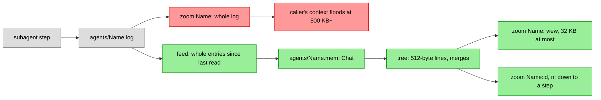

# Subagent memory

A subagent's steps used to live only in `agents/<Name>.log`, and
`zoom("Name")` gave that log whole. A subagent that ran for hours wrote
megabytes: a zoom of one filled or overflowed the caller's context, so a
fresh agent could not pick up its work by reading it.

Now each subagent's chat is a `Chat` of its own in `agents/<Name>.mem`,
with the main chat's code: the same 512-byte lines, pairwise merges, the
same compaction model and prompt, the same view and zoom. Its view is
16 to 32 KB (the main chat's is 64 to 128 KB), small enough for one tool
result. `zoom("Name")` gives the view, and `zoom("Name:id", n)` opens its
line `id+n` as `zoom(id, n)` opens the chat's.

It is on by default. `-agent-memory=false` turns it off: steps go to the
log only, no `.mem` chat is made, `zoom("Name")` gives the whole log as
before, and the prompt and the zoom tool say so.

## How it is fed

The log stays the source. Each subagent has a lock of its own, held over
a step's write to the log and the feed that follows it, and over a zoom's
feed: a feed reads the log from where it last stopped and logs the whole
entries it finds, leaving out thinking, and never reads a step half
written. (Without the lock, a zoom during a long write could cut a step
at a blank line in its text, and the rest of it was lost.) Opened again
(after a restart, or a crash between the log and the chat), a chat skips
as many steps as it holds, counted as its messages' first parts: each
step goes in once.

No lock is shared by all subagents over a file read or write: a first
zoom of one long log holds up no other subagent's steps.

Four locks, always taken in this order: a subagent's own, then the map of
open subagents' chats, then a chat's, then the count of compactions
running. Closing idle chats holds the map's lock, over closing their
files too, and only tries a subagent's own lock, so it never waits
against the order.

A running subagent's chat is opened at its first step and built as it
works. A subagent from before this change gets its tree at its first
zoom. The zoom answers at once: a line not summarized yet shows the heads
of its first and last messages, so the first view already holds the
task, the last report and where the work went, and the rest is built in
the background. At most 32 subagents' chats stay open; past that the
least used idle ones close and open again from their files when needed.

A compaction in a subagent's chat is told whose chat it is and what its
kinds mean (`tool` there is the subagent's own call, `opt` a message Opt
sent it). A failed one shows on the page as the chat's do, named
`[Name] memory:`.

## Cost

All subagents' chats share `-agent-jobs` compactions at once (2), and
start none while the main chat has a line waiting to be built: the main
chat's come first. A main chat line that keeps failing, waiting to be
tried again, holds up none of them. Counted on real logs, a tree takes
about 1.1 to 1.3 compactions per message, so a 500 KB log takes about 540
compactions, about $0.43 at a Haiku compaction's average of $0.0008, and
about 25 minutes at 2 at once. A 1.4 MB log takes about 1,600. A running
subagent's chat costs this as it works, whether or not it is ever
zoomed: about 1.2 compactions per step.

## Prior art

[opencode-optchat](https://github.com/ahlner/opencode-optchat) keeps a
summary tree per session, subagents' included, and keeps a child's
history private to it. UniiChat and pi-optchat page a subagent's log by
characters; neither summarizes it.
